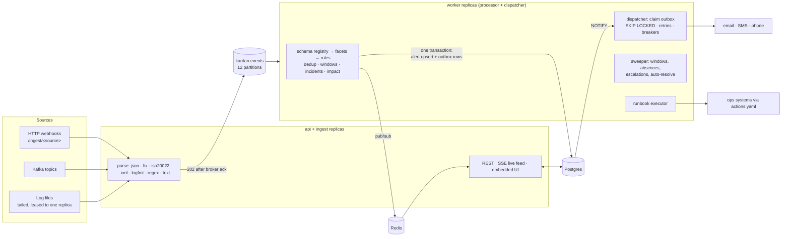

# Architecture

Kardan is one Go binary that runs any mix of four roles (`ROLES=api,ingest,processor,dispatcher`). Replicas are
stateless: state lives in Redpanda (the durable event log), Postgres (alerts, outbox, configuration edits, audit)
and Redis (live fan-out, short leases, sliding windows). Scaling is adding replicas of the role that is the
bottleneck.

## Request path

1. **Ingest** parses the event (format auto-detected per source), wraps it in an envelope with a ULID and the
   original text, and appends it to `kardan.events`. The HTTP answer (`202`) is sent only after the broker
   acknowledged the write (idempotent producer, `acks=all`), so an accepted event cannot be lost at the edge.
2. **Processor** replicas share the topic's partitions through a consumer group. For each batch they identify the
   schema (structural signature), compute facets (`$severity`, `$counterparty`, `$notionalUsd`…), evaluate the
   compiled rules, fold matches by fingerprint, and write alert upserts plus notification rows (the outbox) in
   **one Postgres transaction**. Offsets are committed only after that commit; a crash replays the batch, and the
   partial unique index "one open alert per fingerprint" makes the replay fold into the same alert.
3. **Dispatcher** replicas are woken by `LISTEN/NOTIFY`, claim due rows with `FOR UPDATE SKIP LOCKED` (only as
   many as they have free workers, with a lease), and send through the channel adapters. Failures retry with
   backoff; a per-channel circuit breaker defers sends without spending the retry budget; critical alerts
   activate a pre-rendered fallback channel; exhausted rows become dead letters with a re-send button.
4. **API** replicas serve the UI and REST, and push live updates over server-sent events. Any replica can push any
   update because processors publish to Redis pub/sub.

## Where state lives

| State | Store | Why |
|---|---|---|
| Events | Redpanda topic (replayable) | Durable buffer between edge and processing; also replayed for rule backtests |
| Alerts, incidents, outbox, runs, audit | Postgres | Transactions tie "alert changed" to "notification queued" |
| Rules, runbooks, people and teams edited in the UI | Postgres, merged over `config/` files | Files stay the reviewed baseline; UI edits are versioned overrides that can be reverted |
| Dedup | Postgres partial unique index | Exactly one open alert per fingerprint across all replicas |
| Aggregate windows, absence heartbeats | Redis (Lua, sorted sets / hashes) | Fast sliding windows shared by every processor; replays are idempotent |
| Throttle counters, leases (sweeper, file sources) | Redis | Short-lived coordination without a leader |
| Live fan-out, config-change notices | Redis pub/sub | Every API replica sees every update; every replica reloads config within seconds |

## Failure handling

| Failure | Effect | Why nothing is lost or duplicated |
|---|---|---|
| Processor crashes mid-batch | Batch is re-delivered to another replica | Offsets committed after the DB commit; open-fingerprint unique index folds the replay |
| Dispatcher crashes mid-send | Lease expires, another replica sends | Notification id sent as `Idempotency-Key`; the provider drops the duplicate |
| SMS/voice provider down | Breaker opens, rows wait in `retry`; critical alerts use the fallback channel | Rows stay in the outbox until delivered or dead-lettered (visible, re-sendable) |
| Postgres briefly unavailable | Processing pauses and retries the batch with backoff | Offsets are not committed, events stay in the log |
| Redis unavailable | Live updates pause (clients re-sync from REST on reconnect); throttling fails open | Event rules, alerts and the outbox do not depend on Redis; window-based (aggregate, absence) rules do |
| A replica receives no config notice | Picked up by the 15 s DB version check or the 2 s config-dir poll | Rule sets are swapped atomically per replica |

## Scaling

- **Ingest/API**: stateless HTTP; put replicas behind a load balancer. File sources are leased so only one
  replica tails each file.
- **Processors**: parallelism up to the partition count (12 by default, `EVENTS_PARTITIONS`). Correctness does
  not depend on partition affinity (dedup is enforced in Postgres), so events can be spread freely.
- **Dispatchers**: any number; `SKIP LOCKED` claims never overlap. `DISPATCH_WORKERS` sets concurrent sends per
  replica.
- Measured throughput and latency for 1 and 3 worker replicas are in [`loadtest/results.md`](../loadtest/results.md).

## Configuration as data

Rules, runbooks, sources, teams, calendars, FX and actions are YAML under `config/` (hot-reloaded, read-only in
the UI) and can be overridden or extended through the API/UI (stored in Postgres with versions and optimistic
locking). Changes reach every replica through Redis notices, with polling and version checks as safety nets.
Changes can also go through the [proposal queue](../README.md#proposals-and-fatigue-analysis), where someone other
than the author reviews a diff before it is applied.

## Code map

| Package | Role |
|---|---|
| `cmd/kardan` | the service (roles chosen by `ROLES`) |
| `cmd/fakegw`, `cmd/mockops` | simulated SMS/voice provider and operations estate |
| `cmd/loadgen` | load generator and latency/loss report |
| `internal/ingest` | sources (HTTP, Kafka, files), parsers, producer |
| `internal/schema` | signatures, field detection (ISIN, LEI, IBAN…), facets, severity normalisation |
| `internal/rules` | rule model, compiler, engine (event / aggregate / absence kinds) |
| `internal/processor` | batch processing, dedup, windows, incidents, sweeper, runbook triggers |
| `internal/notify` | channels, rendering, masking, preferences, throttling, dispatcher |
| `internal/runbooks`, `internal/runner`, `internal/actions` | runbook parsing (any shape), execution, approvals |
| `internal/audit` | hash-chained audit log |
| `internal/directory` | people, teams, preferences, on-call, UI overrides |
| `internal/replay` | reads past events back for backtests |
| `internal/ai` | optional Claude assistance with built-in fallbacks |
| `internal/proposals` | review queue and fatigue analysis |
| `internal/api` | REST, SSE, embedded UI |
| `web/` | React UI (Vite, TypeScript, Tailwind), embedded into the binary |
